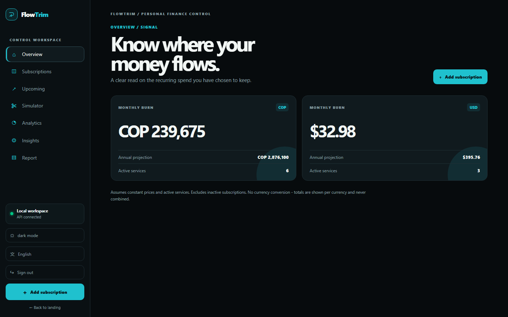
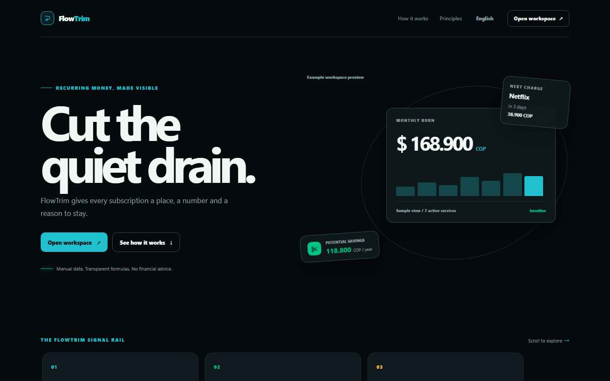
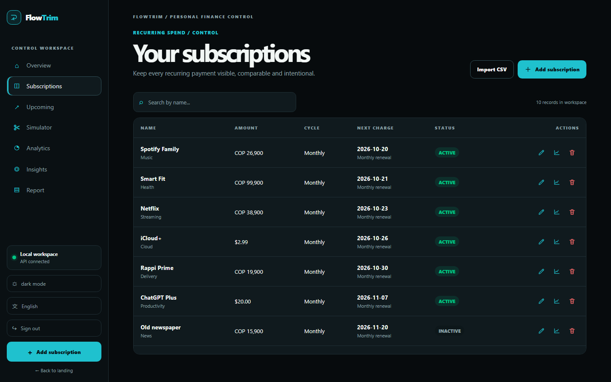
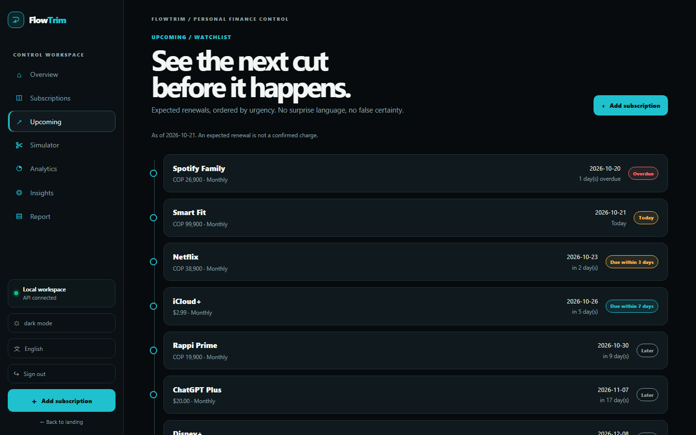
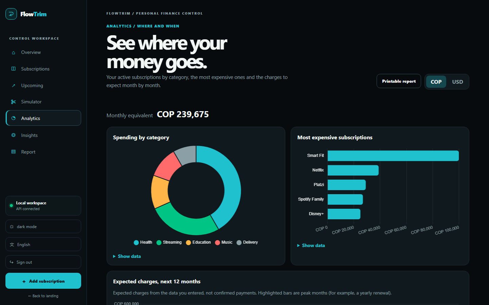
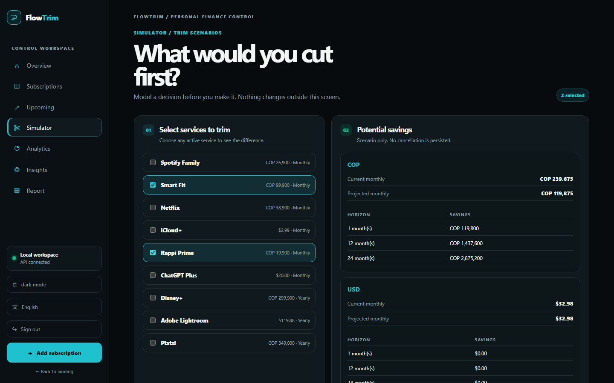
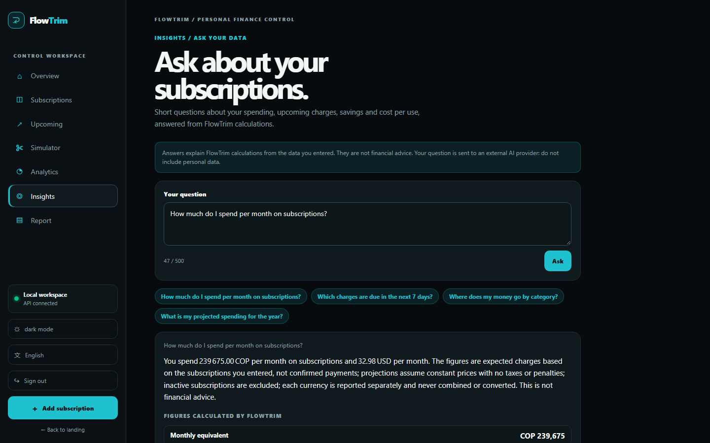
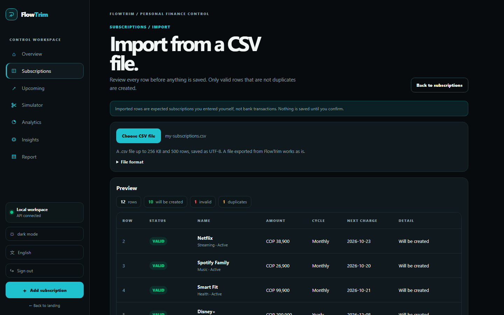

<div align="center">

# FlowTrim

**Cut the quiet drain.** See every recurring charge, its real monthly cost and what you would save by cutting it.

[](https://github.com/Andermc10/FlowTrim-frontend/actions/workflows/ci.yml)


[API](https://github.com/Andermc10/FlowTrim-backend) · [Specs & backlog](https://github.com/Andermc10/FlowTrim-tracker) · [CSV format](https://github.com/Andermc10/FlowTrim-tracker/blob/main/docs/SUBSCRIPTION-CSV-FORMAT.md)



</div>

## What you can do

| | |
|---|---|
| **Know your burn** | Monthly equivalent and annual projection per currency, never mixed or converted. |
| **Never be surprised** | Upcoming charges with a countdown and alert windows, plus one in-app heads-up per session for anything overdue or due within 3 days. |
| **Find the waste** | Spending by category, the most expensive services and the expected charges month by month. |
| **Decide before you cut** | The simulator shows savings at 1, 12 and 24 months. It cancels nothing and always shows its assumptions. |
| **Ask in plain words** | Insights answers short questions from FlowTrim's own calculations; the figures come from the backend, not from the AI's text. |
| **Bring your data** | Import a CSV with a row-by-row preview (errors and duplicates) before anything is saved; export it back or print a PDF report. |

FlowTrim is a manual-data portfolio project: it never connects to banks and never presents an expected renewal as a payment.

## Screenshots

> Dark theme with fictional data.

| | |
|---|---|
|  |  |
|  |  |
|  |  |
|  | |

## Built with

- **Angular 21**: standalone components, signals, lazy routes; strict TypeScript and SCSS.
- **Carbon Signal** design system with CSS custom properties: persisted light and dark themes, reduced-motion support and no UI library.
- **Chart.js 4** behind a reusable chart component (lazy, so the initial bundle stays under 500 kB).
- **English and Spanish** in the client, with a test that keeps both languages' keys in sync.
- **OIDC Authorization Code + PKCE**: no passwords in the app, token in `sessionStorage`, guarded `/app/**`.
- **Vitest** for unit tests and **Playwright** for the critical browser flow.

## Quick start

Requirements: Node `^20.19`, `^22.12` or `>=24` and the [API](https://github.com/Andermc10/FlowTrim-backend) running on `http://localhost:5214`.

```bash
npm ci
npm start        # http://localhost:4200
npm test         # unit tests
npm run build    # production build in dist/
```

## Configuration

`src/environments/environment*.ts` hold the API URL and the **public** OIDC values (they reach the browser by design; they are not secrets). `angular.json` swaps them per build with `fileReplacements`.

| File | `apiUrl` | Used by |
|---|---|---|
| `environment.ts` | `http://localhost:5214` | `npm start` |
| `environment.production.ts` | `''` (same origin) | `npm run build` |
| `environment.e2e.ts` | `http://localhost:5214` | `npm run e2e` (local test issuer) |

To use your own Auth0 tenant, create a **Single Page Application** with callback `http://localhost:4200/auth/callback`, logout URL `http://localhost:4200/` and web origin `http://localhost:4200`, then set `authority`, `clientId`, `audience` (the API's `Authentication:Audience`) and `scope`.

<details>
<summary><b>How the session works</b></summary>

- The interceptor adds the bearer token only to `<apiUrl>/api/…`, never to the identity provider.
- A `401` from the API clears the session and the login page explains that it expired.
- Sign-out also ends the provider session when it publishes `end_session_endpoint`.
- `returnUrl` only accepts internal routes (no open redirects); refresh tokens are not used.

</details>

## Routes

| Path | Screen |
|---|---|
| `/` | Landing |
| `/auth/login`, `/auth/callback` | Sign-in handoff and PKCE callback |
| `/app` | Overview (monthly burn per currency) |
| `/app/subscriptions` | List, search, create, edit, delete |
| `/app/subscriptions/import` | CSV import with preview |
| `/app/subscriptions/:id/usage` | Declared usage and cost per use |
| `/app/upcoming` | Upcoming charges and countdown |
| `/app/simulator` | Cancellation simulator |
| `/app/analytics` | Charts by category, top services, expected charges |
| `/app/insights` | Questions about your data |
| `/app/report` | Printable report and CSV export |

## Project structure

```
src/app/
  core/       auth (guard, interceptors, PKCE), i18n, theme, money/date formatting, files,
              ui (modal, toast, chart, icon)
  features/   landing · auth · subscriptions · summary · simulator · analytics · insights · reports · imports
src/styles.scss   design tokens and shared building blocks (buttons, banners, data tables)
e2e/              Playwright flow, local OIDC test issuer, static SPA server
```

Every data view handles loading, empty, success and error states. Unexpected errors show the API's correlation reference so a failure can be found in the logs.

## Quality

- **Unit tests** (`npm test`): services, pages, guards, interceptors, pipes and the language parity check.
- **Browser flow** (`npm run e2e`): sign-in → create → Insights figure equals the overview → account isolation → CSV import → delete, failing on any console error or failed request. It starts a local OIDC issuer, the real API and an e2e build; see [e2e/README.md](e2e/README.md).
- **CI** (`.github/workflows/ci.yml`): `npm ci`, unit tests and the production build on every pull request, with no secrets. `main` is protected.

## Known limitations

- Manual data only; no bank integration or charge detection.
- Needs an OIDC tenant for the workspace (Auth0 free works).
- No public deployment yet: run it locally with the API.

Deferred technical items: [docs/TECH-DEBT.md](docs/TECH-DEBT.md).
