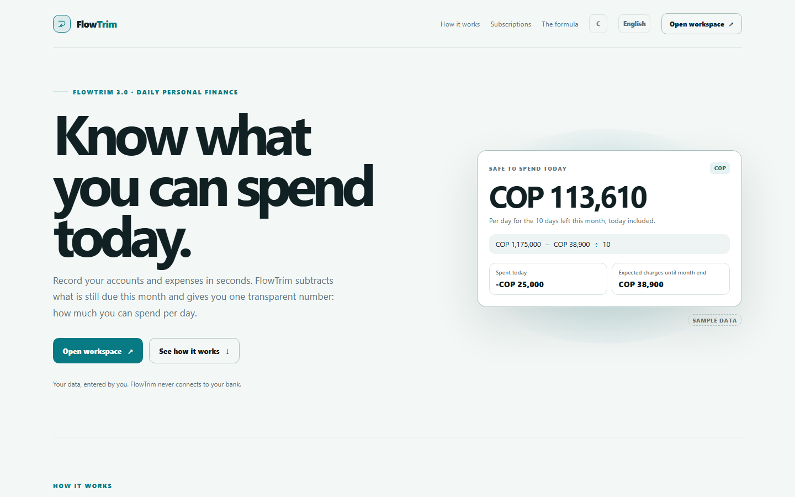
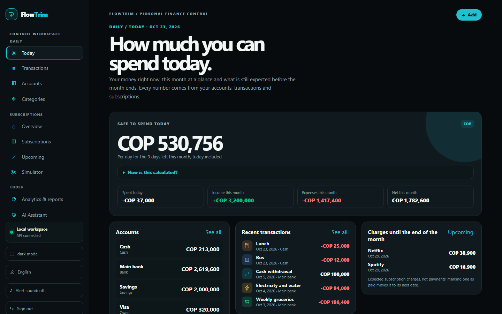
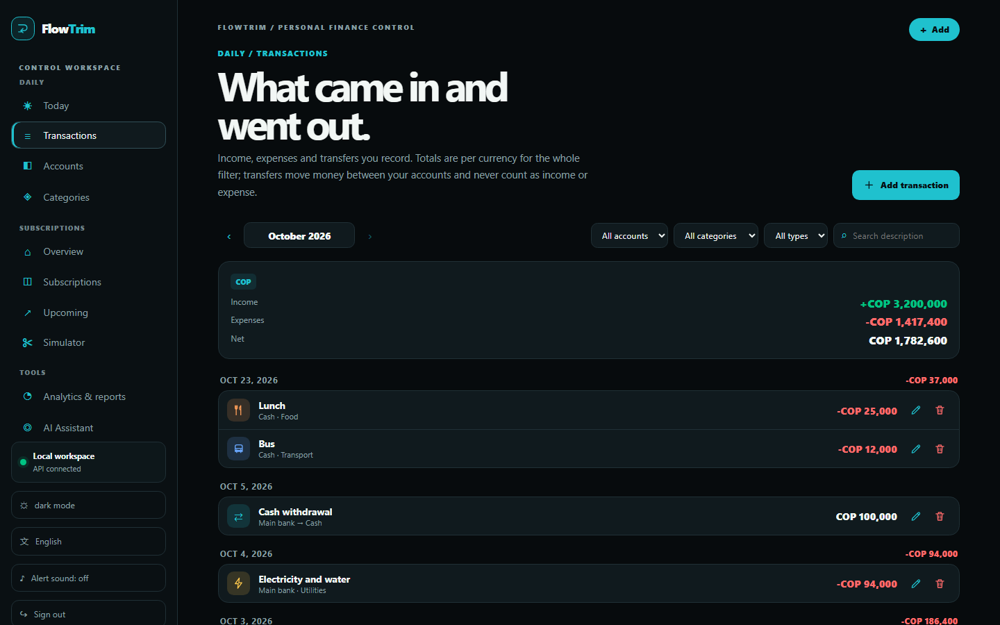
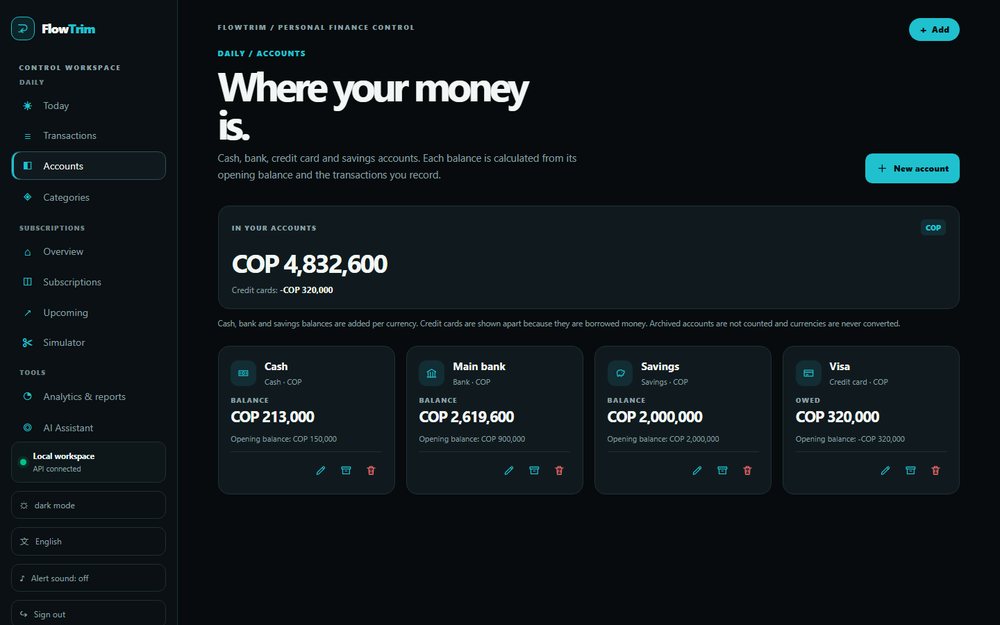
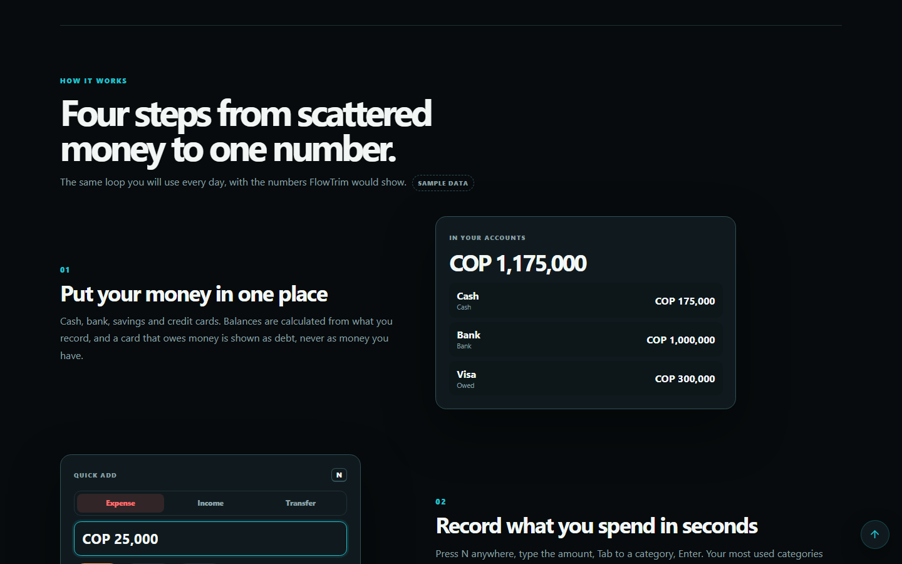

<div align="center">

# FlowTrim

**Cut the quiet drain.** See every recurring charge, its real monthly cost and what you would save by cutting it.

[](https://github.com/Andermc10/FlowTrim-frontend/actions/workflows/ci.yml)


[API](https://github.com/Andermc10/FlowTrim-backend) · [Specs & backlog](https://github.com/Andermc10/FlowTrim-tracker) · [CSV format](https://github.com/Andermc10/FlowTrim-tracker/blob/main/docs/SUBSCRIPTION-CSV-FORMAT.md)


</div>

## What you can do

| | |
|---|---|
| **Know what you can spend today** | The **Today** home shows, per currency, how much you can spend per day until the month ends: (available money − expected subscription charges) ÷ days left, with every input and the formula one click away. Credit cards are not counted as available money. |
| **Track daily money** | Accounts (cash, bank, credit card, savings) with balances computed from your transactions; your own expense and income categories with a color and an icon; income, expenses and same-currency transfers by month, grouped by day. |
| **Record in seconds** | Press **N** anywhere in the workspace (or "+ Add"): amount, Tab to a category, Enter. Your most used categories come first and the last account is remembered. |
| **Know your burn** | Monthly equivalent and annual projection per currency, never mixed or converted. |
| **Never be surprised** | Upcoming charges with a countdown and alert windows, one in-app heads-up per session (with an optional sound) for anything overdue or due within 3 days, and **Mark as paid** to move a charge to its next cycle. |
| **Find the waste** | Analytics & reports: spending by category, the most expensive services and the expected charges month by month, next to a themed, printable report. |
| **Decide before you cut** | The simulator shows savings at 1, 12 and 24 months. It cancels nothing and always shows its assumptions. |
| **Ask in plain words** | The AI Assistant answers short questions from FlowTrim's own calculations; the figures come from the backend, not from the AI's text. |
| **Bring your data** | Import a CSV (comma or Excel's semicolon style) with a row-by-row preview before anything is saved; export it back or print a PDF report. |

Forms guide you with examples and show each error as you type; dates follow the America/Bogota calendar like the API.

FlowTrim is a manual-data portfolio project: it never connects to banks, records only the transactions you enter and never presents an expected renewal as a payment. "Safe to spend today" is an estimate, not financial advice.

## Screenshots

> Dark theme with fictional data, unless noted.

| | |
|---|---|
|  |  |
|  |  |
|  |  |
|  |  |
|  |  |
|  |  |

## Built with

- **Angular 22**: standalone components, signals, OnPush everywhere, lazy routes; strict TypeScript 6 and SCSS.
- **Carbon Signal** design system with CSS custom properties: persisted light and dark themes, reduced-motion support and no UI library.
- **Chart.js 4** behind a reusable chart component; every workspace screen is lazy (initial bundle ≈ 433 kB).
- **GSAP 3.15 + ScrollTrigger** only on the landing, loaded with a dynamic `import()` after the first render (two lazy chunks, never in the initial bundle and never requested with reduced motion). The landing is complete without it: on desktop the daily story pins and scrubs through four steps, on phones the steps simply reveal.
- **English and Spanish** in the client, with a test that keeps both languages' keys in sync.
- **OIDC Authorization Code + PKCE**: no passwords in the app, token in `sessionStorage`, guarded `/app/**`.
- **Vitest** for unit tests and **Playwright** for the critical browser flow.

## Quick start

Requirements: Node `^22.22.3`, `^24.15` or `>=26` and the [API](https://github.com/Andermc10/FlowTrim-backend) running on `http://localhost:5214`.

```bash
npm ci
npm start        # http://localhost:4200
npm test         # unit tests
npm run lint     # ESLint (angular-eslint)
npm run build    # production build in dist/
```

## Configuration

`src/environments/environment*.ts` hold the API URL and the **public** OIDC values (they reach the browser by design; they are not secrets). `angular.json` swaps them per build with `fileReplacements`.

| File | `apiUrl` | Used by |
|---|---|---|
| `environment.ts` | `http://localhost:5214` | `npm start` |
| `environment.production.ts` | `''` (same origin) | `npm run build` |
| `environment.e2e.ts` | `http://localhost:5214` | `npm run e2e` (local test issuer) |

To use your own Auth0 tenant, create a **Single Page Application** with callback `http://localhost:4200/auth/callback`, logout URL `http://localhost:4200/` and web origin `http://localhost:4200`, then set `authority`, `clientId`, `audience` (the API's `Authentication:Audience`) and `scope`.

<details>
<summary><b>How the session works</b></summary>

- The interceptor adds the bearer token only to `<apiUrl>/api/…`, never to the identity provider.
- A `401` from the API clears the session and the login page explains that it expired.
- Sign-out is immediate: it clears the local session and redirects to the provider's `end_session_endpoint` (saved at
  sign-in, so no request is made first). For Auth0, add `http://localhost:4200/` (and your deployed origin) to
  **Allowed Logout URLs**; otherwise Auth0 shows an error page instead of returning to FlowTrim.
- Auth0 always shows the consent screen when the app runs on `localhost`. On a real domain, enable **Allow Skipping
  User Consent** on the API so first-party users are asked only once; with Google, use your own Google OAuth client
  instead of Auth0's development keys.
- `returnUrl` only accepts internal routes (no open redirects); refresh tokens are not used.

</details>

## Routes

| Path | Screen |
|---|---|
| `/` | Landing |
| `/auth/login`, `/auth/callback` | Sign-in handoff and PKCE callback |
| `/app` | Today: safe to spend today per currency, month figures, accounts, recent transactions, charges until month end |
| `/app/transactions` | Transactions by month: filters, rows grouped by day, totals per currency |
| `/app/accounts` | Accounts with computed balances, archive, delete when unused |
| `/app/categories` | Expense and income categories with color and icon |
| `/app/summary` | Subscriptions overview (monthly burn per currency) |
| `/app/subscriptions` | List, search, create, edit, delete |
| `/app/subscriptions/import` | CSV import with preview |
| `/app/subscriptions/:id/usage` | Declared usage and cost per use |
| `/app/upcoming` | Upcoming charges and countdown |
| `/app/simulator` | Cancellation simulator |
| `/app/analytics` | Analytics & reports: Charts tab (category, top services, expected charges) |
| `/app/analytics/report` | Report tab: printable report and CSV export (`/app/report` redirects here) |
| `/app/insights` | AI Assistant: questions about your data |

## Project structure

```
src/app/
  core/       auth (guard, interceptors, PKCE), i18n, theme, money/date formatting, files,
              forms (shared validators, field errors), ui (modal, toast, chart, icon, sound, back-to-top)
  features/   landing · auth · today · transactions · accounts · categories · subscriptions · summary · simulator · analytics · insights · reports · imports
src/styles.scss   design tokens and shared building blocks (buttons, banners, data tables)
e2e/              Playwright flow, local OIDC test issuer, static SPA server
```

Every data view handles loading, empty, success and error states. Unexpected errors show the API's correlation reference so a failure can be found in the logs.

## Quality

- **Unit tests** (`npm test`): services, pages, guards, interceptors, pipes and the language parity check.
- **Browser flow** (`npm run e2e`): sign-in → create with live validation → AI Assistant figure equals the overview → account isolation → CSV import and template → mark as paid → report tab → delete, failing on any console error or failed request. It starts a local OIDC issuer, the real API and an e2e build; see [e2e/README.md](e2e/README.md).
- **CI** (`.github/workflows/ci.yml`): `npm ci`, ESLint, unit tests and the production build on every pull request, with no secrets. `main` is protected.

## Known limitations

- Manual data only; no bank integration or charge detection.
- Needs an OIDC tenant for the workspace (Auth0 free works).
- No public deployment yet: run it locally with the API.

Deferred technical items: [docs/TECH-DEBT.md](docs/TECH-DEBT.md).
