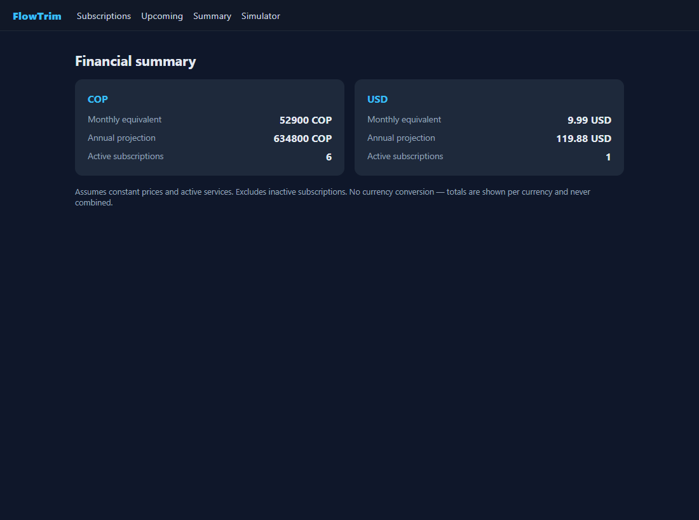

# FlowTrim-frontend

[](https://github.com/Andermc10/FlowTrim-frontend/actions/workflows/ci.yml)

Angular single-page application for **FlowTrim** — a deterministic, transparent engine to track
recurring subscriptions, compute monthly-equivalent and annual spending, warn about upcoming
renewals, and simulate cancellation savings. This repository holds the web client; the API lives in
[`FlowTrim-backend`](https://github.com/Andermc10/FlowTrim-backend).

## Features

- **Subscriptions** — list (with name search), create, edit and delete (with confirmation).
- **Summary** — financial summary per currency (monthly equivalent, annual projection, active count).
- **Upcoming** — upcoming charges with a server-computed countdown and colored alert windows.
- **Simulator** — pick subscriptions to cancel and see the potential savings at 1/12/24 months.
- **Usage** — record declared usage and view cost per use, including a safe not-calculable state.
- **Landing and workspace** — a product introduction at `/` and a responsive control workspace at `/app`.
- **Themes** — persisted light and dark modes using the Carbon Signal visual system.
- **Localization** — client-side English and Spanish interface with persisted preference.
- **Secure access** — OIDC Authorization Code + PKCE handoff, session-scoped access token and protected workspace routes.
- **Landing motion** — CSS/SVG motion, scroll-snap feature rail and reduced-motion support without an animation dependency.
- Every data-driven view handles **loading / empty / success / error** states; errors go through a
  central HTTP interceptor and show an actionable message.

## Tech stack

- Angular 21 (standalone components, signals, routing; SSR disabled)
- TypeScript (strict mode), SCSS
- Vitest for unit tests

## Requirements

- Node.js `^20.19` or `^22.12` or `>=24` (Angular 21). Angular 22 needs Node `>=22.22.3`.
- npm 10+

## Getting started

```bash
npm install          # install dependencies (.npmrc sets legacy-peer-deps; see docs/TECH-DEBT.md)
npm start            # dev server at http://localhost:4200 (ng serve)
npm run build        # production build into dist/
npm test             # unit tests (Vitest)
```

**Continuous integration:** `.github/workflows/ci.yml` runs `npm ci`, the unit tests and the production
build on every pull request to `main` and every push to `main`. It needs no secrets. `main` is protected:
a pull request cannot be merged while the `test-and-build` check is failing.

The backend must be running for live data — start it on the `http` profile (`http://localhost:5214`)
and bring up its PostgreSQL container. See the backend README.

## API configuration (environments)

The API base URL is per-environment and swapped at build time via `angular.json` `fileReplacements`:

| File | `apiUrl` | Used by |
|---|---|---|
| `src/environments/environment.ts` | `http://localhost:5214` | `ng serve` / dev build |
| `src/environments/environment.production.ts` | `''` (same origin) | `ng build` (production) |

Change `apiUrl` to point the SPA at a different API, with no code changes. CORS for the dev origin
(`http://localhost:4200`) is configured on the backend.

## Authentication (Auth0)

The SPA never handles passwords. It signs in with **Auth0** using Authorization Code + PKCE.

Auth0 setup — **Applications → Single Page Application**:

| Setting | Local value |
|---|---|
| Allowed Callback URLs | `http://localhost:4200/auth/callback` |
| Allowed Logout URLs | `http://localhost:4200/` |
| Allowed Web Origins | `http://localhost:4200` |

Both `environment.ts` (development) and `environment.production.ts` use the public values of the
FlowTrim Auth0 tenant (`dev-flowtrim.us.auth0.com`); a separate production tenant is not needed at
portfolio scale. When the app is deployed (HU-40), register the production callback, logout URL and web
origin in the Auth0 SPA settings. For another tenant, set the public values in
`src/environments/environment*.ts` (they are visible in the browser by
design and are not secrets):

```ts
auth: {
  authority: 'https://<tenant>.<region>.auth0.com',
  clientId: '<spa-client-id>',
  audience: 'https://api.flowtrim.dev', // same as the API's Authentication:Audience
  scope: 'openid profile email',
}
```

Behavior:

- `/app/**` is protected by a guard; without a valid token it redirects to `/auth/login?returnUrl=…`.
- The interceptor attaches the bearer token only to `<apiUrl>/api/…` requests (exact prefix match),
  never to the identity provider.
- If the API answers `401`, the session is cleared and the login page shows a "session expired" notice.
- Sign-out clears the local session and ends the Auth0 session when the provider exposes
  `end_session_endpoint`.
- Access tokens live in `sessionStorage` only; refresh tokens are intentionally not used.
- `returnUrl` only accepts internal routes (open-redirect protection).

## Routes

| Path | View |
|---|---|
| `/` | FlowTrim landing page |
| `/auth/login` | OIDC login handoff |
| `/auth/callback` | PKCE callback and token exchange |
| `/app` | Workspace overview |
| `/app/subscriptions` | Subscription list (search, edit, delete) |
| `/new` | Create a subscription |
| `/:id/edit` | Edit a subscription |
| `/:id/usage` | Record usage and view cost per use |
| `/upcoming` | Upcoming charges + countdown |
| `/summary` | Financial summary dashboard |
| `/simulator` | Cancellation simulator |

## Project structure

```
src/
  app/
    core/                       cross-cutting (auth and HTTP interceptors, route guard)
    features/
      auth/                     login and OIDC callback
      core/theme/                persisted light/dark theme service
      features/landing/          public landing page
      subscriptions/             list, form, usage, upcoming panel, models, service
      summary/                  summary dashboard, model, service
      simulator/                simulator, models, service
    app.routes.ts, app.config.ts, app.ts/html/scss
  environments/                 environment.ts / environment.production.ts
  styles.scss                   global styles
public/                         static assets
```

## Screenshots

> Captured from the running app (sample data; dark fintech theme).

| | |
|---|---|
| Landing |  |
| Workspace |  |
| Subscriptions |  |
| Summary |  |
| Upcoming |  |
| Simulator |  |

## Known limitations

- **Manual data only**; no bank integration or automatic charge detection.
- **Auth0 tenant required** — the workspace needs the Auth0 SPA values above; without them the login
  page shows a configuration error.
- The visual system is implemented with SCSS, CSS custom properties and inline SVG; Tailwind and chart libraries remain optional future decisions.
- Full in-browser integration needs the backend running with CORS (HU-08).

## Notes

- `.npmrc` sets `legacy-peer-deps=true` as a temporary workaround for an npm 10.9.2 bug resolving
  Vitest's peer graph. See [`docs/TECH-DEBT.md`](docs/TECH-DEBT.md) (TD-001, TD-002).
- Planning, user stories and specs live in the `FlowTrim-tracker` repository.
